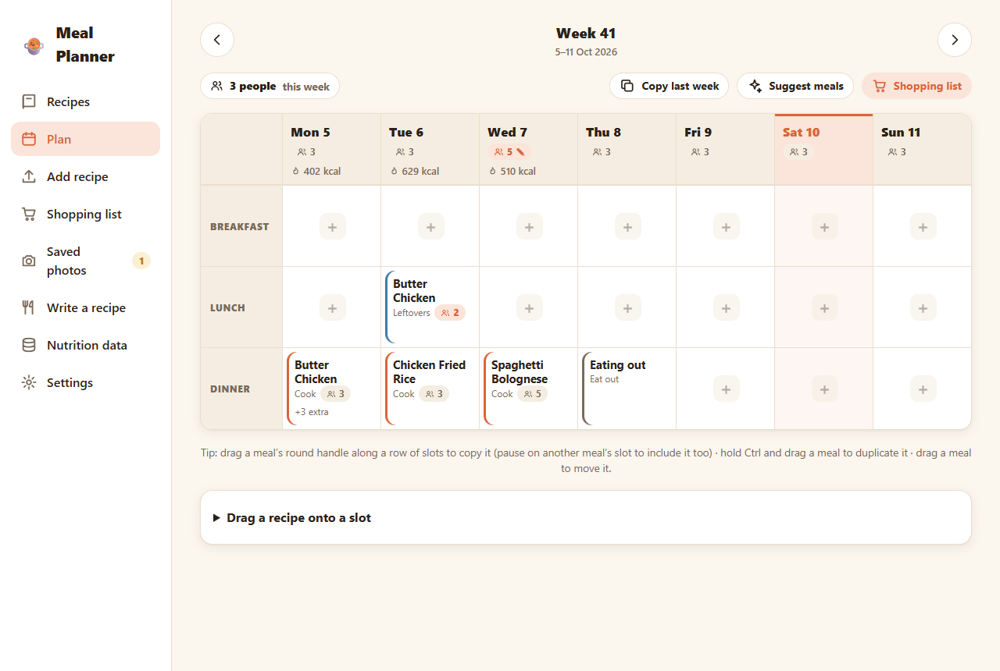
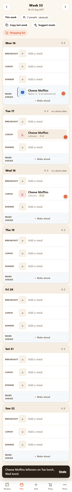
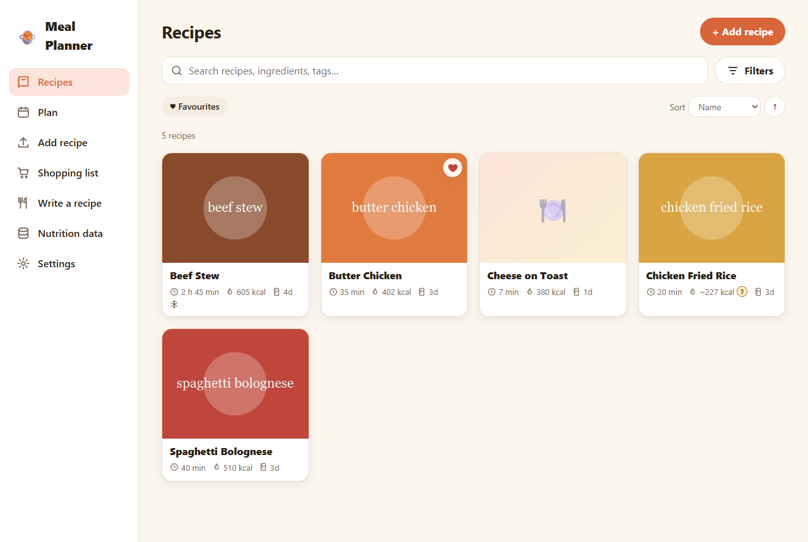
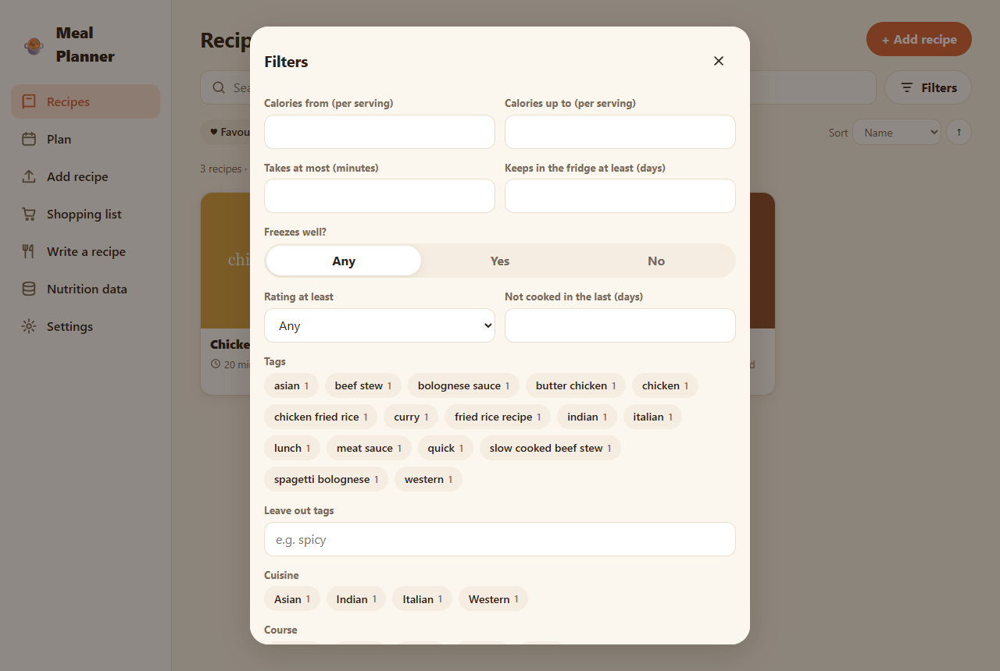
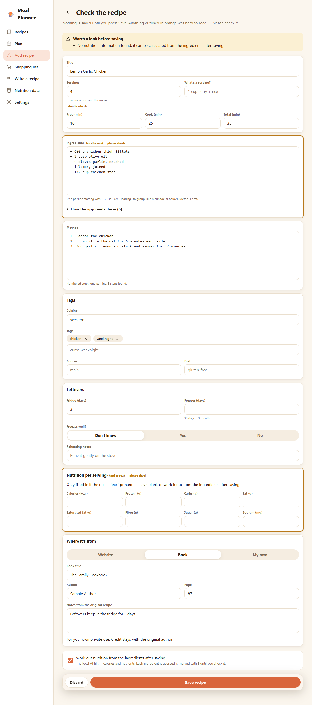
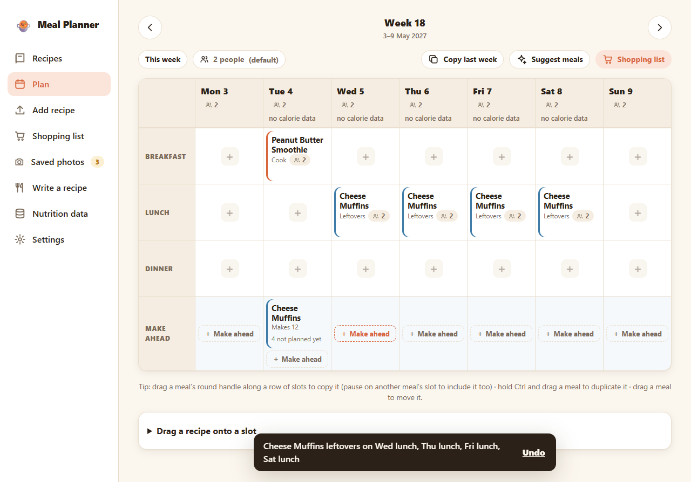
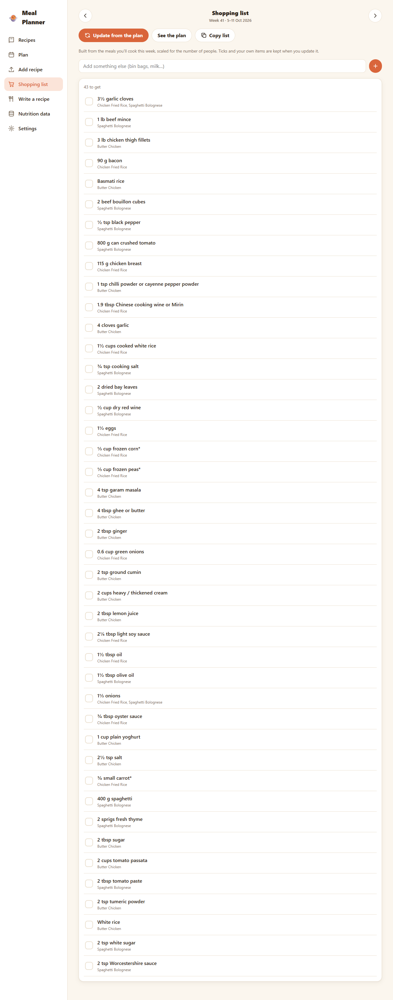
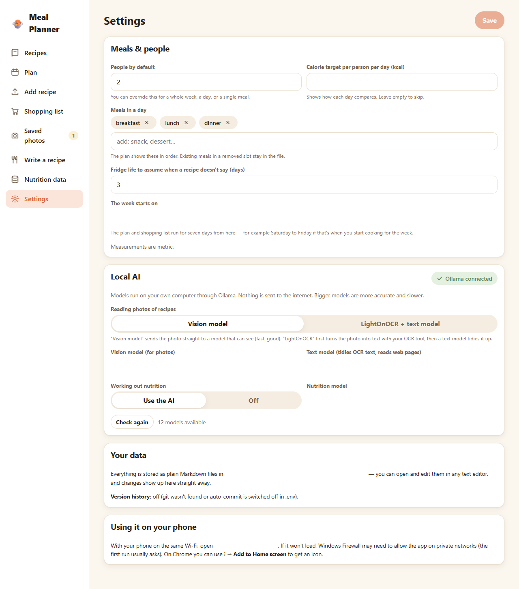
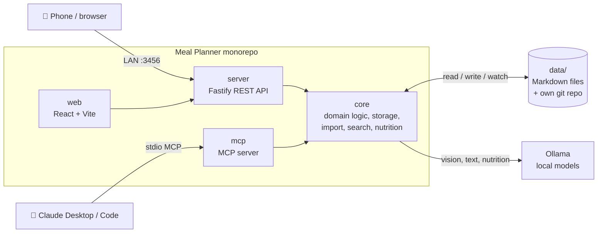

# 🍲 Meal Planner

**A private recipe collection and weekly meal planner that runs on your own computer, works on your phone, and keeps everything as plain Markdown files.**

Import a recipe from a link or a photo of a cookbook page, then plan the week by dragging meals around. The app keeps track of leftovers, fridge and freezer life, people and calories, and builds the shopping list for you. The AI features run on **local models through Ollama**, so nothing is sent to the internet.



📖 **[User manual](docs/MANUAL.md)** explains how to use every feature, with screenshots.

---

## Why it's good

- **🥡 It understands leftovers.** Cook extra on Sunday and the plan counts the portions as they're eaten over the week, even into the next week. It warns you when food would be past its safe date or there isn't enough left, and lets you freeze portions to use later. **Make-ahead** batches (muffins, char siu for the week's lunches) are handled the same way.
- **🖱️ Plan by dragging.** Drag a meal's handle along a row to repeat it, Ctrl-drag to duplicate, or drag to move. Works with a mouse or a finger. **Smart** mode decides whether each copy is leftovers or a fresh cook based on fridge life, and every change can be undone.
- **📸 Read cookbook photos with a local AI.** Photos are saved first and read later, by a vision model or OCR, or you can type the recipe in yourself next to the picture. Every result is reviewed before it's saved.
- **🔢 Shows where nutrition numbers came from.** Any value the AI guessed has an orange **?** until a person confirms it. Correct a food once in the nutrition database and every recipe that uses it is updated.
- **🛒 Builds the shopping list.** It combines the same ingredient across recipes, converts compatible units and scales to the people eating. You can tick items off on your phone, and your ticks and own items survive when the list is rebuilt.
- **📄 Your data stays readable.** Recipes and plans are Markdown files you can open in Notepad. The app reloads when a file changes, never silently overwrites your edits, and saves every change to its own git repository for full version history.
- **🤖 Works with Claude.** An MCP server with 23 tools lets Claude Desktop or Claude Code search recipes, plan the week, find leftovers and write the shopping list.
- **📱 Designed for the phone first.** On a Pixel it shows a card per day with a bottom tab bar. On a desktop it's a full week table. Add it to the home screen and it works like an app.

| Recipe | Nutrition with AI markers | Make ahead |
|---|---|---|
|  |  |  |

<details>
<summary><b>More screenshots</b></summary>

| | |
|---|---|
|  |  |
|  |  |
|  |  |

All 56 screenshots are in [`docs/screenshots/`](docs/screenshots/). The test suite regenerates them.
</details>

---

## Engineering quality

| | |
|---|---|
| **Tests** | **144 unit, API and MCP tests** (Vitest) and **110 end-to-end browser tests** (Playwright, real Edge). The browser tests use a real mouse *and* real touch events, run at phone and desktop sizes, and fail on any browser error. |
| **Real-world fixtures** | The importer is tested against saved copies of real recipe pages. robots.txt handling, rate limiting and the User-Agent are covered by tests. |
| **Safe with your data** | Tests always run against throwaway folders and never touch `data/`. File writes are atomic, with modified-time conflict checks (HTTP 409, then *keep mine / discard mine* in the UI). Unchanged files are never rewritten, and unknown fields are kept. |
| **Visual regression** | Every e2e run refreshes the screenshots, replacing an image only when more than 3 % of its pixels changed, so the docs stay up to date without noise. |
| **Type safety** | Strict TypeScript across the whole monorepo, with zod schemas validating every file and API boundary. `pnpm typecheck` is clean. |
| **Decisions on record** | [`DECISIONS.md`](DECISIONS.md) records every judgement call and its reason. [`PROGRESS.md`](PROGRESS.md) tracks the milestones and known gaps. |

### Architecture



- **`core`** contains all the domain logic and has no HTTP code: recipes, plans, leftovers, shopping, search (MiniSearch), the import pipeline (JSON-LD, page notes, storage advice), nutrition and git auto-commit. The web app reuses its leftover and plan logic.
- **`server`** is a thin Fastify REST API that also serves the built web app.
- **`web`** is React + Vite, mobile-first. Dragging uses pointer events rather than HTML5 drag-and-drop, so mouse, pen and touch behave the same.
- **`mcp`** is a stdio MCP server with the same capabilities. It works without the web app running.

About 14,000 lines of TypeScript. The server and MCP run directly with `tsx`, and only the web app is built.

---

## Start it

1. Double-click **`start.bat`** (the first run builds the web app), or run `npm run start` after a one-off `pnpm install`.
2. The window prints two addresses:
   - On the computer: `http://localhost:3456`
   - On your phone (same Wi-Fi): `http://<this-computer's-IP>:3456`, for example `http://192.168.1.20:3456`
3. If the phone can't connect, allow the port through Windows Firewall. Do this once, in an *administrator* PowerShell:
   ```powershell
   New-NetFirewallRule -DisplayName "Meal Planner" -Direction Inbound -Protocol TCP -LocalPort 3456 -Action Allow -Profile Private
   ```
   In Chrome on a Pixel, tap ⋮ → **Add to Home screen**.
4. Keep Ollama running if you want the photo and nutrition features.

There is deliberately no login, because the app is for a trusted home network. Don't expose the port to the internet.

Then read the **[user manual](docs/MANUAL.md)**.

## Where your data lives

Your data lives in `./data` in this folder (change it with `DATA_DIR` in `.env`). The folder has its own git repository, which saves every change automatically a few seconds after you make it. That gives full version history, which you can also see per recipe in the app (⋯ → Version history).

```
data/
  settings.md            people, meals, AI models…
  nutrition-db.md        every food's per-100 g nutrition (view/edit in the app)
  recipes/<slug>/recipe.md + images/
  photos/<name>/photo.md + images/   saved photos waiting to be read (or already used)
  meal-plans/2026-W41.md
  shopping-lists/2026-W41.md
  .trash/  .cache/       deleted recipes · thumbnails/uploads (safe to delete)
```

You can edit any file in a text editor while the app runs. The app reloads automatically, and it never overwrites a file that changed under it without telling you.
To back up, copy the folder, or `git push` it somewhere private.

### Testing without touching real data
Point the app at another folder: `DATA_DIR=./test-data pnpm start` (in PowerShell: `$env:DATA_DIR="./test-data"; pnpm start`). All automated tests use temporary folders. `packages/core/scripts/seed-demo.mts <empty-dir>` fills a scratch folder with demo recipes.

## Features in detail

- **Saved photos:** take a photo with your phone's camera, or pick pictures from the gallery or computer, give it a name, and **save it for later**. None of this needs the AI. Read it whenever you like, now or later with a different model chosen just for that reading, or **type it in yourself with the photo beside the form**. Photos live in `data/photos/<name>/` as plain files. When one becomes a recipe, its pages are kept as the recipe's source pages.
- **Import** a recipe from a link (it reads the site's structured recipe data, notes and storage advice), from several pasted links, or from photos of a cookbook page (with a local vision model, or LightOnOCR plus a text model). You always review before anything is saved, and uncertain fields are outlined.
- **Nutrition:** uses the page's numbers when it has them. Otherwise the local AI works them out from the ingredients. Every AI-filled ingredient has an orange **?** until someone edits it; it then counts as "entered by hand" and the ? disappears. The **Nutrition data** page lists and edits every food.
- **Leftovers:** fridge and freezer life come from the recipe's notes. The plan tracks portions, can freeze them, and warns when a leftovers meal is past its safe date or uses more than exists.
- **Filters:** calories, time, days it keeps, freezable, tags/cuisine/course/diet, main or side, favourites, hidden, rating, "not cooked lately", nutrition source, free text.
- **Plan:**
  - **Dragging:** drag a meal's round handle along a row of slots to extend it (for example, lunch for the rest of the week), Ctrl-drag a meal to duplicate it, or drag it to move it. This works with a finger too (hold a meal to pick it up) and with taps, and every change has an Undo.
  - **Leftovers across days and weeks:** Sunday's dinner can feed Monday's lunch and Tuesday's dinner, even into next week, and the app cooks enough for everyone.
  - **Starts today:** the plan shows the next 7 days from today, and steps back and forward 7 days at a time. Plans are saved one file per week (the week can start on any day you choose in Settings).
  - **Layout:** on a wide screen the plan is a table with a column per day and a row per meal; on a phone each day is a card. A slot can hold several dishes (a main and a side).
  - **Make ahead:** cook something on one day without eating it that day, using the row under the meals, then choose which later meals eat it. It warns if a meal would eat it past its safe date, and portions can be frozen.
  - **People and calories:** people can be set for the days shown, a day or a meal, and the UI always shows where a number came from. Quantities scale, and calories are shown per person per day.
  - **Other tools:** mark meals cooked (this updates the cook log), copy the 7 days before, and suggest dinners. Removing a cooked meal removes the leftovers planned from it.
- **Shopping list:** generated from the cook meals in the 7 days shown, combined and scaled, and tickable on your phone.
- **MCP server** so Claude Desktop and Claude Code can search recipes, plan the week, and more.

## Use it from Claude (MCP)

The MCP server uses the same data folder as the web app and works without the web app running. Use the exact path of this folder.

Claude Desktop (`claude_desktop_config.json`):
```json
{
  "mcpServers": {
    "meal-planner": {
      "command": "node",
      "args": ["C:/Users/culli/code/Meal Planner/packages/mcp/run.mjs"]
    }
  }
}
```
Claude Code:
```
claude mcp add meal-planner -- node "C:/Users/culli/code/Meal Planner/packages/mcp/run.mjs"
```
**Tools:** `save_recipe_photo`, `list_recipe_photos`, `read_recipe_photo`, `copy_meal`, `search_recipes`, `get_recipe`, `create_recipe`, `update_recipe`, `import_recipe_from_url`, `import_recipe_from_image` (file paths on this computer), `add_recipe_note`, `set_favorite`, `set_hidden`, `recalculate_nutrition`, `get_meal_plan`, `set_meal`, `set_people`, `mark_meal_cooked`, `list_available_leftovers`, `suggest_meal_plan`, `generate_shopping_list`, `get_settings`, `update_settings`.

**Resources:** `recipe://{slug}`, `mealplan://{week}`, `settings://`.

## Settings via `.env`

See `.env.example` for `DATA_DIR`, `PORT`, `HOST`, `OLLAMA_URL`, `LIGHTONOCR_DIR` and `GIT_AUTOCOMMIT`. Models are chosen on the app's Settings page. The Ollama address can also be set there (handy when Ollama runs on another computer); it overrides `OLLAMA_URL`, which stays the fallback when the field is empty.

## Development

```
pnpm dev            # API on :3456 + Vite on :5173 (hot reload; open :5173)
npm run test:unit   # unit + API + MCP tests
npm run test:e2e    # end-to-end browser tests (below)
npm run test:all    # both
pnpm typecheck
```
Packages: `core` (everything except HTTP), `server` (Fastify REST API, also serves the web app), `web` (React + Vite), `mcp`.
Live model checks: `pnpm --filter @mp/core exec tsx scripts/live-check.mts nutrition|photo`.
Save fixture pages: `pnpm --filter @mp/core exec tsx scripts/fetch-fixture.mts <url>`.

### End-to-end tests and screenshots

`npm run test:e2e` drives a real browser (the Microsoft Edge that comes with Windows, so there's nothing to download) against **throwaway copies of the app**: one on port 3470 with demo recipes, a plan and a shopping list, and one on port 3471 that's empty, like a first run. Their data lives in `.e2e/` and is wiped each run, so your real `data/` is never touched. The web app is rebuilt first if it's out of date.

- `e2e/nav.spec.ts` clicks through every page (phone tab bar and desktop sidebar) and checks each page really shows (no blank screen). It also covers reloads, Back/Forward, deep links and unknown addresses, both with data and on an empty install. Every e2e test also fails on any browser error.
- `e2e/flows.spec.ts` covers real journeys: write a recipe, search and filters, favourite and hide, plan a meal, people overrides, cook extra and eat leftovers, mark cooked, shopping list ticks, the nutrition "?" markers, notes/rating/edit, importing from a link (mocked page), and settings.
- `e2e/photos.spec.ts` covers saving photos (camera and gallery buttons), naming, reading later with a chosen model, typing it in, failures and delete. Set `LIVE_AI=1` to also read the real `_reference/Daal Curry.jpg` with your local model.
- `e2e/weekstart.spec.ts` checks the plan layout (measured on screen) and switches the week start to Saturday and back without losing a meal (the plan still starts today).
- `e2e/makeahead.spec.ts` covers cooking ahead: smoothies drunk tomorrow, and muffins cooked tomorrow and eaten later in the week, with none eaten on the cooking day. It also covers freezing, too-late warnings, drag-to-eat, moving and shopping.
- `e2e/plan-drag.spec.ts` covers the fill handle, Ctrl-drag, move, choose-slots mode, leftovers across weeks and undo, with a real mouse and real touch events.
- `e2e/shots.spec.ts` takes screenshots of every page and main dialog at phone (Pixel 7) and desktop size.

**The screenshots in `docs/screenshots/`** are refreshed after every run by `scripts/compare-screenshots.mts`. It only replaces an image when more than a threshold of its pixels changed (default **3 %**), so tiny rendering differences don't create noise. You can change the threshold in three ways, in priority order: `--threshold N`, the `SCREENSHOT_THRESHOLD` environment variable, or `thresholdPercent` in `e2e/screenshot-config.json`.
```
npm run screenshots:compare -- --threshold 5      # run the comparison on its own
SCREENSHOT_THRESHOLD=1 npm run test:e2e           # stricter for one run
SKIP_SCREENSHOT_UPDATE=1 npm run test:e2e         # run the tests without touching docs/
```
To look at a failure, run `npx playwright show-report`. Traces and screenshots are kept for failed tests.

## Copyright

Imported recipes belong to their authors. Each recipe stores its source (a link, or a book and page) and shows it on the recipe page. The app only fetches URLs you paste and never crawls. It makes at most one request every 2 seconds to any site, sends an identifying User-Agent, and checks robots.txt first. There is no sharing or publishing feature.
