# Meal Planner: user manual

This manual explains how to use Meal Planner day to day: collecting recipes, planning the week, using leftovers, and going shopping. To install it or work on the code, see the [README](../README.md).

All screenshots below come from the automated browser tests, so they show the app as it is today.

## Contents

1. [Getting started](#1-getting-started)
2. [Finding your way around](#2-finding-your-way-around)
3. [Adding recipes](#3-adding-recipes)
4. [Saved photos](#4-saved-photos)
5. [Browsing, searching and filtering](#5-browsing-searching-and-filtering)
6. [A recipe page](#6-a-recipe-page)
7. [Nutrition](#7-nutrition)
8. [Planning the week](#8-planning-the-week)
9. [Leftovers, freezing and make-ahead cooking](#9-leftovers-freezing-and-make-ahead-cooking)
10. [Shopping list](#10-shopping-list)
11. [Settings](#11-settings)
12. [Your data, history and backups](#12-your-data-history-and-backups)
13. [Using it with Claude (MCP)](#13-using-it-with-claude-mcp)
14. [Troubleshooting](#14-troubleshooting)

---

## 1. Getting started

1. On the computer that holds your recipes, double-click **`start.bat`**. The first run takes a minute because it builds the app.
2. The window shows two addresses:
   - **On this computer:** `http://localhost:3456`
   - **On your phone** (same Wi-Fi): something like `http://192.168.1.20:3456`
3. On your phone in Chrome, tap **⋮ → Add to Home screen** and it opens like an app.
4. For reading recipe photos and working out nutrition, also keep **Ollama** running. Everything else works without it.

There's no login. The app is meant for a trusted home network, so don't open its port to the internet.

## 2. Finding your way around

| Desktop | Phone |
|---|---|
|  | 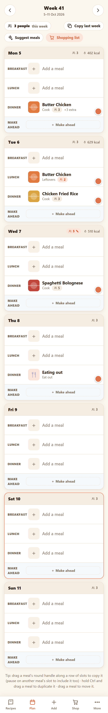 |

On a wide screen the menu runs down the left side. On a phone there's a tab bar at the bottom: **Recipes · Plan · Add · Shop · More**, and **More** holds the rest.

| Page | What it's for |
|---|---|
| **Recipes** | Your collection: search, filter, open a recipe |
| **Plan** | This week's meals, people, calories and leftovers |
| **Add recipe** | Import from a link, several links, or photos of a cookbook |
| **Shopping list** | Everything to buy for the week's cooking |
| **Saved photos** | Cookbook photos waiting to be read or typed in (the badge shows how many) |
| **Write a recipe** | Type a recipe in from scratch |
| **Nutrition data** | The food database behind the calorie numbers |
| **Settings** | People, meals, week start, AI models |

Most changes pop up an **Undo** message at the bottom of the screen.

## 3. Adding recipes

### From a web page

**Add recipe → Link.** Paste the recipe's address and the app reads it, including ingredients, method, times, nutrition, notes and storage advice ("keeps 3 days in the fridge").

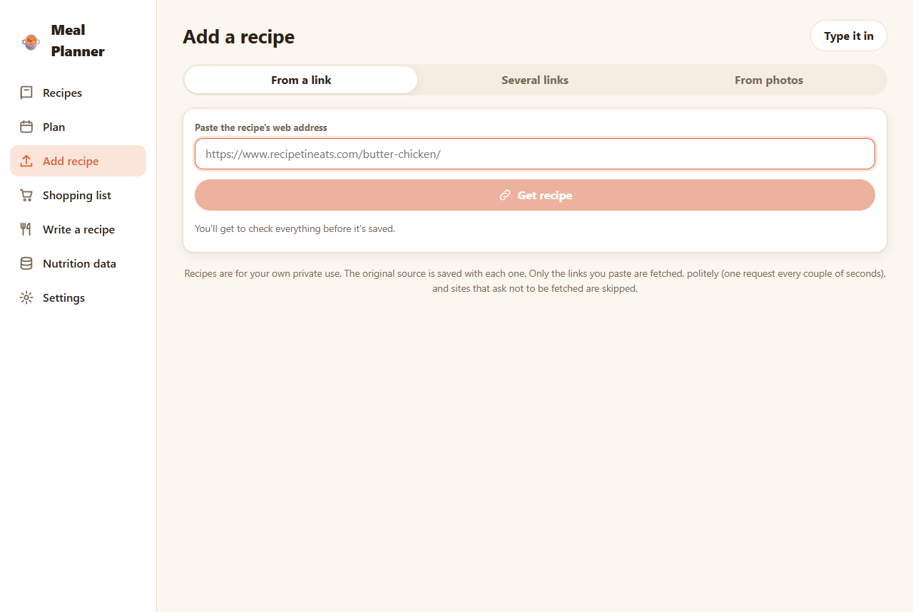

Nothing is saved until you've checked it on the **review** screen. Fields the app wasn't sure about are outlined so you can see what to check.


**Several links at once:** paste one link per line. Each one becomes a draft for you to review, unless you tick *save straight away*.

The app only fetches links you paste. It checks each site's robots.txt and makes no more than one request every 2 seconds to any site.

### From a cookbook photo

**Add recipe → Photos.** Take a photo with the camera button, or choose pictures from the gallery or the computer. A recipe that runs over two pages can have more than one picture. See [Saved photos](#4-saved-photos) for what happens next.

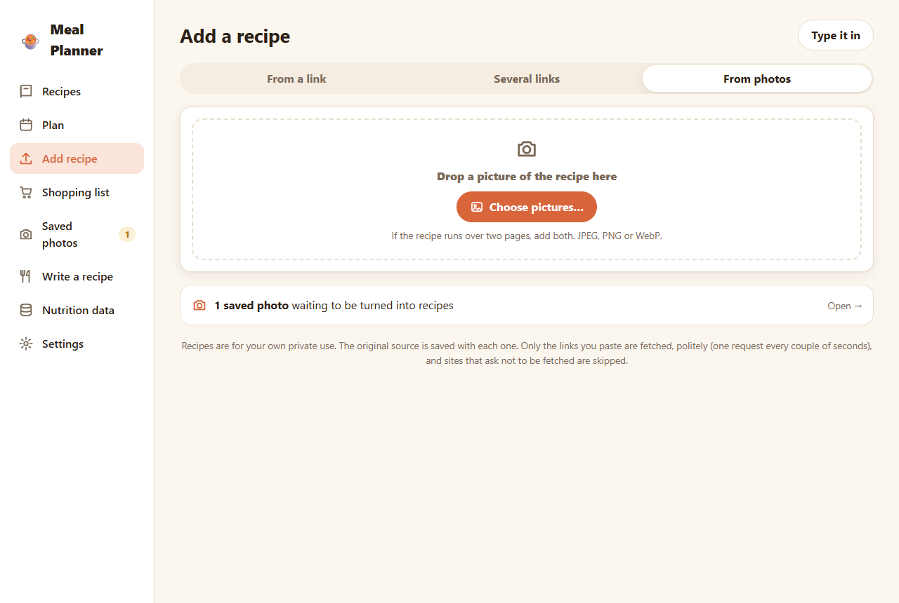

### Writing one yourself

**Write a recipe** opens an empty form: title, servings, times, ingredients (one per line, such as `600 g chicken thighs`), method, tags, and whether it's a **main**, a **side** or both.

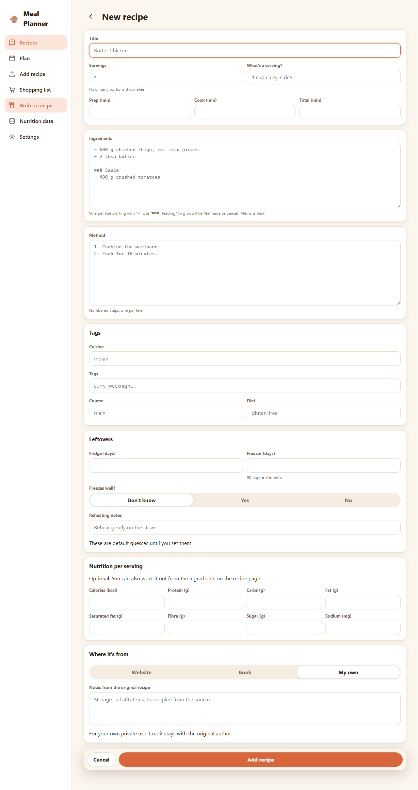

## 4. Saved photos

A photo is **saved first and read later**, so you can snap a page in someone's kitchen now and deal with it at home. A failed or poor reading never loses the photo.

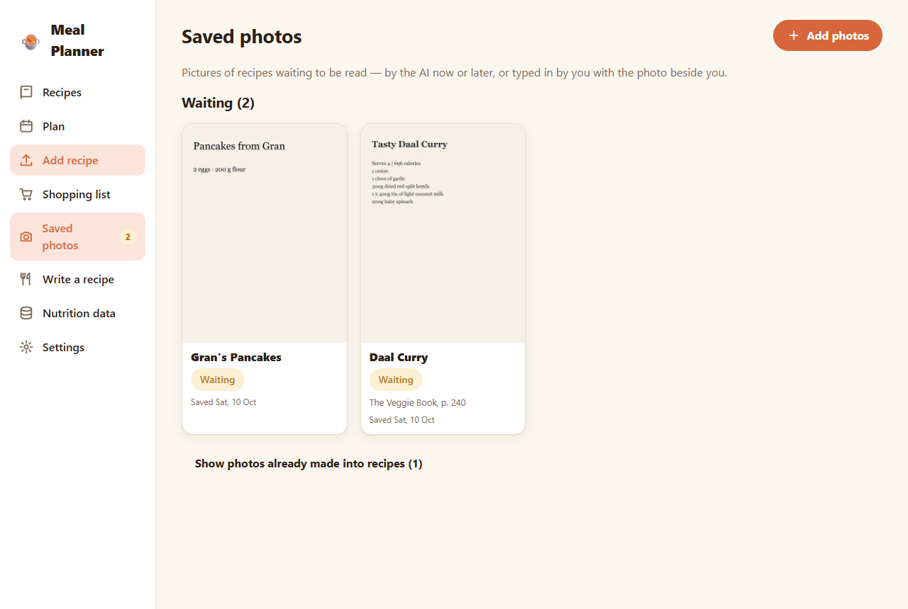

For each saved photo you can:

- **Read it with the AI.** You can pick a different model just for this reading, without changing Settings.
- **Type it in yourself**, with the photo shown next to the form.
- **Rename** or **delete** it.

When a photo becomes a recipe, its pages are kept with the recipe as source pages, so you can always look back at the original.

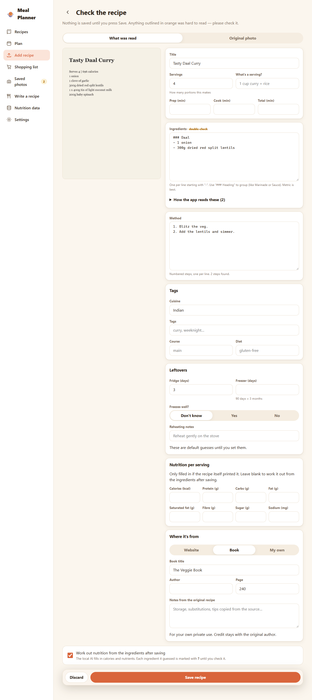

Phone photos in HEIC format aren't supported. Pixel phones save JPEG by default, so this usually doesn't come up.

## 5. Browsing, searching and filtering


- **Search** matches titles, ingredients, tags and notes as you type.
- **Mains / Sides**: the list shows mains by default. Switch to see sides, or both.
- **Favourites** (♥) and **hidden** recipes (hidden ones stay out of the way and out of suggestions).
- **Sort** by name, calories, time, rating, last cooked or date added, either way round.

**Filters** narrows the list down:


- calories per serving (from/up to)
- total time
- how many days it keeps in the fridge
- whether it freezes well
- rating
- *not cooked in the last N days*
- tags (include or leave out), cuisine, course, diet
- where the nutrition numbers came from

If a calorie filter leaves recipes out because they have no calorie data, the app tells you how many.

## 6. A recipe page

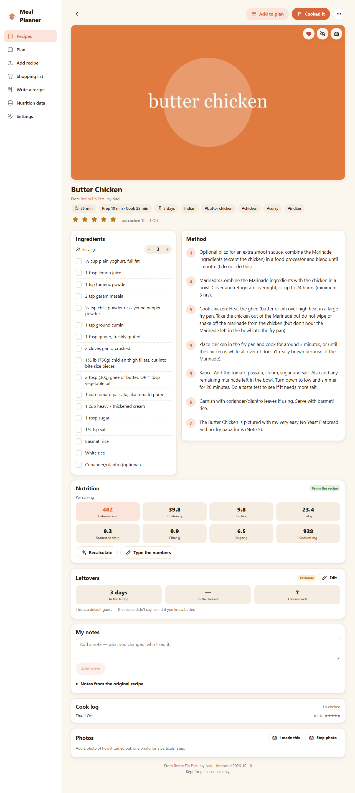

- **Servings −/+** rescales every ingredient. When you open a recipe from the plan, it's already scaled to the portions you're cooking.
- **Tick ingredients** as you go.
- **Add to plan** puts it on a day and meal.
- **Cooked it** adds it to the **cook log** with an optional star rating. "Last cooked" and "not cooked lately" use this.
- **♥** favourite, **hide**, and a **camera** button for a main photo.
- **Leftovers** shows fridge life, freezer life and whether it freezes. It's read from the recipe's own notes where possible, marked *Estimate* if not, and editable.
- **My notes** are your own notes ("less chilli next time"). **Notes from the original recipe** are kept separately.
- **Photos**: add *I made this* or step photos.
- **⋯ menu**: Edit, **Edit Markdown file** (the raw file), **Version history** (see and restore any earlier version), **Rename folder**, Delete (it goes to a trash folder, not gone for good).

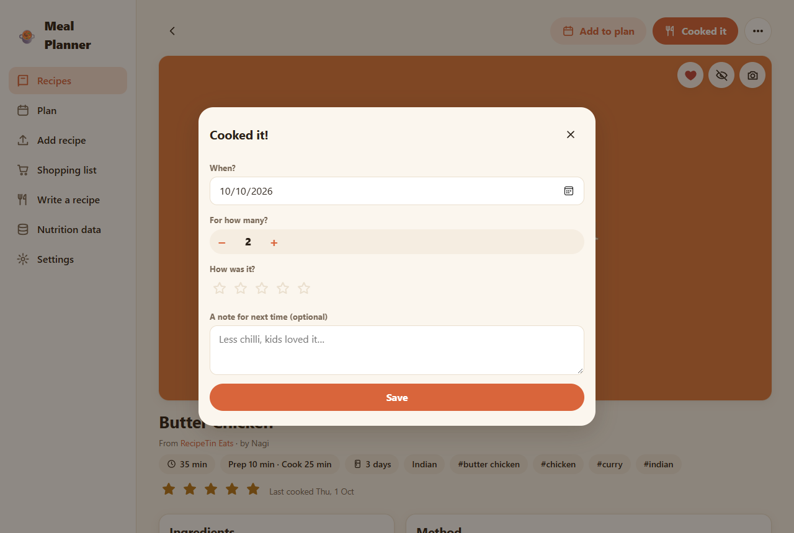

## 7. Nutrition

Every recipe shows calories, protein, carbs, fat, saturated fat, fibre, sugar and sodium per serving. The label next to them says where the numbers came from:

- **From the recipe:** the web page published them.
- **Calculated estimate:** the local AI worked them out ingredient by ingredient.
- **Entered by hand:** you typed them in.

### The orange "?"

Open **Show ingredient breakdown** to see each ingredient's grams and nutrients. **Any value the AI guessed has an orange ?** next to it.

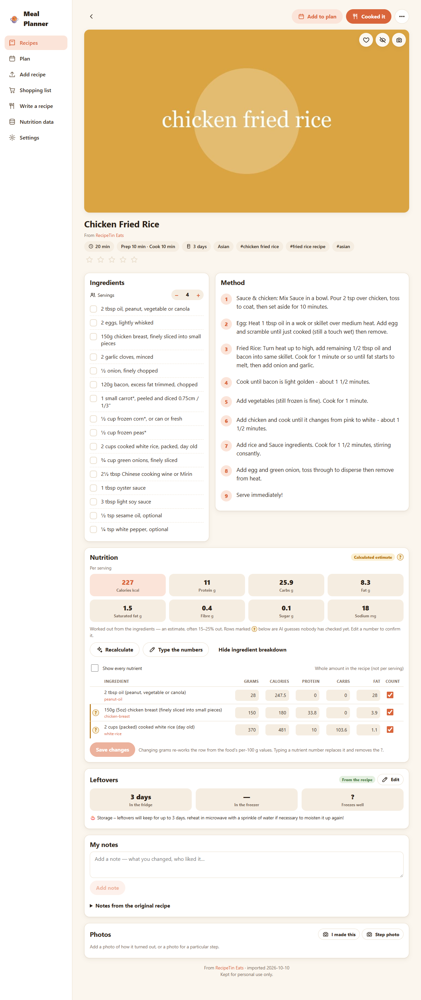

- Type a number, or tap the **?**, to confirm a row. The ? goes away and the row counts as *entered by hand*.
- If you change only the grams, the row is recalculated from that food's per-100 g values.
- **Recalculate** asks the AI again, but keeps every row you've already confirmed.
- **Type the numbers** lets you enter per-serving values directly, for example from a packet.

### Nutrition data

Every food the app knows about is stored per 100 g on the **Nutrition data** page. If you fix a value there (say the AI got butter wrong), **every recipe that uses it is re-totalled**, and later recipes use the corrected value.

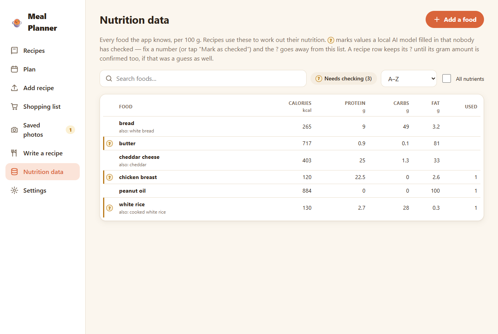

## 8. Planning the week


On a wide screen the plan is a table, with a column per day and a row per meal. On a phone each day is a card. Use the arrows to move between weeks.

### Putting meals on the plan

- Tap **+** in a slot and choose **Cook**, **Leftovers**, **Eat out** or **Skip**.
- Or open **Drag a recipe onto a slot** under the plan and drag one in (desktop).
- Or press **Add to plan** on a recipe page.
- **+ Add another** puts more than one dish in a slot, such as meatloaf with honey-glazed carrots.

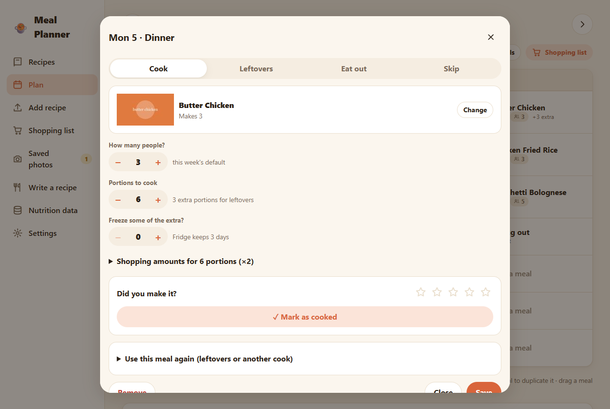

### Dragging (mouse, finger or pen)

| To… | Do this |
|---|---|
| **Copy a meal along a row** (lunch for the rest of the week) | Drag the meal's **round handle** across the slots. To include a different meal row too, pause on it for a moment. |
| **Choose slots by tapping** | Click the round handle once, tap the slots you want, then **Apply** |
| **Duplicate** | Hold **Ctrl** and drag the meal |
| **Move** | Drag the meal itself (on a phone, press and hold to pick it up) |

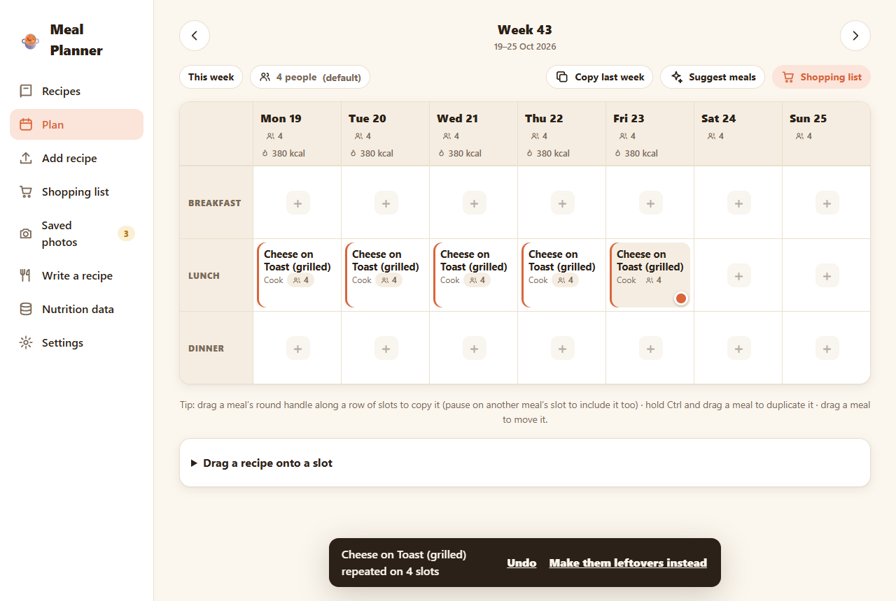

When you copy a cook meal, the app works out a sensible default (**Smart** mode). If the food will still be safe on those days, the copies become **leftovers** and the original meal cooks enough for everyone. If not, each copy becomes a fresh **cook**. The message at the bottom lets you **Undo** or switch to the other choice. In the meal dialog, **Use this meal again** does the same thing with buttons instead of dragging.

### People

People can be set at three levels, and the most specific one wins: **the meal**, then **the day**, then **the week**, then the default in Settings. The app always shows where a number came from. A pencil mark means it was changed for that day or meal.

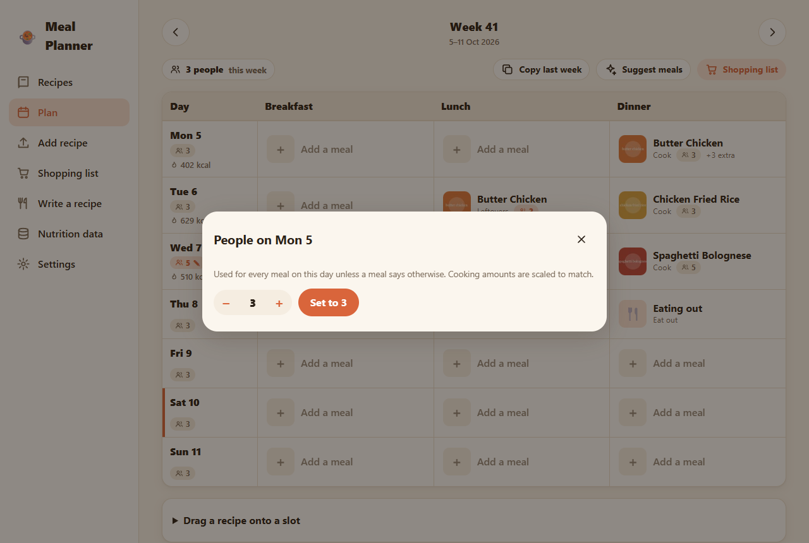

Ingredient quantities and the shopping list scale to the number of people.

### Calories per day

Each day's header shows calories **per person**. If you set a daily target in Settings, it also shows how far over or under each day is.

### Marking meals cooked, copying and suggestions

- In a cook meal's dialog, **Cooked** adds it to the recipe's cook log.
- **Copy last week** copies a whole week. Dates move, and the cooked ticks reset.
- **Suggest meals** fills empty dinners. It prefers favourites, high ratings and recipes you haven't cooked lately, and it cooks double when tomorrow's lunch is free. You see a preview first, and nothing is saved until you accept it.

### Starting the week on another day

If you shop and cook at the weekend, set **The week starts on** to Saturday in Settings. The plan and shopping list then run Saturday to Friday, and no meals are lost when you switch.

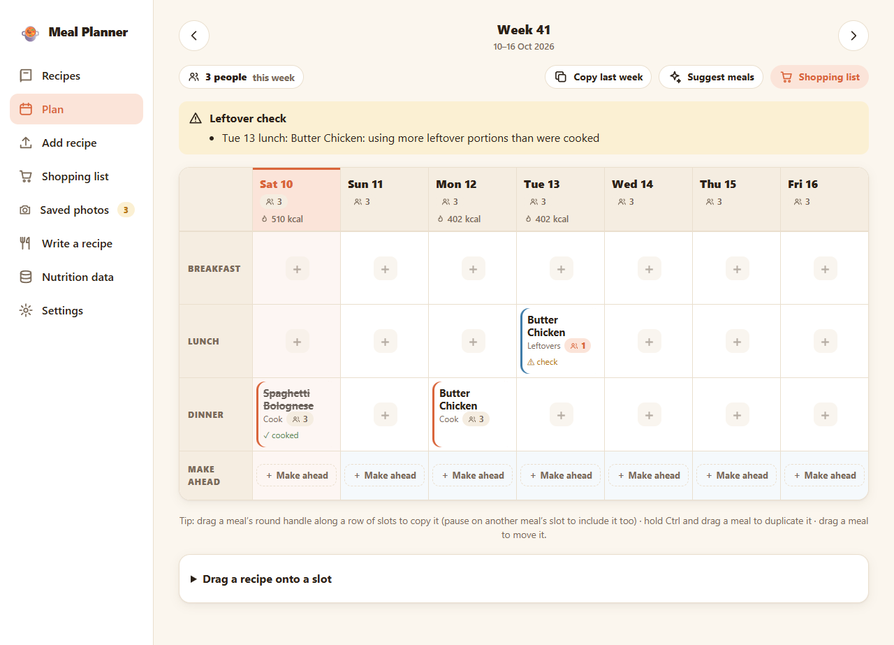

## 9. Leftovers, freezing and make-ahead cooking

### Cooking extra

Open a cook meal and raise **Portions to cook** above the number of people. The extra portions become leftovers that later meals can use.

### Eating leftovers

Set a slot to **Leftovers** and pick from the list. It shows only food that has portions left and is still within its safe date, for example *"Cooked Sun 11 Oct · 2 portions left in the fridge · safe until Wed 14 Oct"*.

The app keeps count across the whole plan, even across weeks: a Sunday dinner can feed Monday's lunch in the next week.

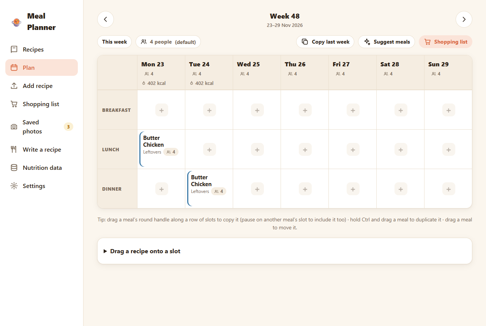

A meal with a ⚠ **check** label has a problem:

- the leftovers are past their safe date
- more portions are being eaten than were cooked
- they're eaten before the day they're cooked
- the meal they came from was removed

### Freezing

In the cook meal, choose how many extra portions to **freeze**. Frozen portions get the recipe's freezer life instead of its fridge life. A leftovers meal can then take them **from the freezer**. You get a warning if the recipe is marked as not freezable.

### Make ahead

The **Make ahead** row under the meals is for food you cook on one day but don't eat that day, such as Sunday's batch of muffins or char siu for the week's lunches.


1. Press **+ Make ahead** on the cooking day, choose the recipe and how much it makes.
2. Drag from it onto the meals that will eat it (pause on the first one, then sweep along the row), or click it and tick the meals.
3. The make-ahead card counts down, for example *"4 not planned yet"*.

Make-ahead food goes on the shopping list but isn't counted in that day's calories, because nobody eats it that day. If a meal would eat it past its fridge life, you get a warning and the option to freeze some.

## 10. Shopping list


- **Update from the plan** builds the list from every meal you'll **cook** this week, scaled to the people eating. Leftover meals don't add anything, because that food is already cooked.
- The same ingredient from different recipes is **combined** (garlic cloves from two recipes become one line), and compatible units are merged (tbsp + ml, g + kg).
- Under each item you can see which recipes need it.
- **Tick items** in the shop on your phone.
- **Add something else** for things that aren't in a recipe (bin bags, milk).
- Ticks and your own items are **kept** when you update the list again.
- **Copy list** puts the list on the clipboard to paste into another app.

## 11. Settings


- **People by default** and **Calorie target per person per day**
- **Meals in a day**: breakfast, lunch and dinner by default. You can add *snack* or *dessert*.
- **Fridge life to assume when a recipe doesn't say** (days)
- **The week starts on**: any day
- **Local AI**: the status of the Ollama connection, and which model reads photos, which tidies text, and which works out nutrition. You can also use **LightOnOCR + a text model** instead of a vision model, or turn AI nutrition off.
- **Your data**: where the files are, and whether version history is on.

## 12. Your data, history and backups

Everything is stored as **plain Markdown files** in the `data` folder. You can open any recipe in Notepad, edit it, and the app updates straight away. If a file changes while you're editing the same thing in the app, the app asks whether to **keep yours or discard yours** rather than silently overwriting.

```
data/
  settings.md
  nutrition-db.md
  recipes/butter-chicken/recipe.md + images/
  photos/<name>/photo.md + images/
  meal-plans/2026-W41.md
  shopping-lists/2026-W41.md
  .trash/                deleted recipes
```

- **Version history:** the data folder is its own git repository and saves every change automatically a few seconds after you make it. On any recipe, **⋯ → Version history** lets you see and restore earlier versions.
- **Backup:** copy the `data` folder, or push its git repository somewhere private.

## 13. Using it with Claude (MCP)

Meal Planner includes an MCP server, so Claude Desktop or Claude Code can work with the same recipes and plans. For example:

> *"Plan dinners for next week. Nothing we've had in the last fortnight, and something freezable on Sunday."*
> *"What leftovers can we eat on Thursday?"*
> *"Import this recipe and add it to Wednesday's dinner for 4."*

The README has the [setup steps](../README.md#use-it-from-claude-mcp) and the list of tools.

## 14. Troubleshooting

| Problem | Fix |
|---|---|
| The phone can't open the address | It must be on the same Wi-Fi. Allow port 3456 through Windows Firewall (see the README). |
| "Ollama not connected" in Settings | Start Ollama, then press **Check again**. |
| Reading a photo is slow | Local models take 20–80 seconds per page. A smaller model in Settings is faster but less accurate. |
| A photo won't upload | It's probably HEIC. Save or share it as JPEG instead. |
| The leftovers you want aren't in the list | Check that the cook meal has extra **Portions to cook**, and that the day you picked is within its safe date. |
| You made a mistake | Use **Undo** in the message at the bottom, or **⋯ → Version history** on a recipe. |
